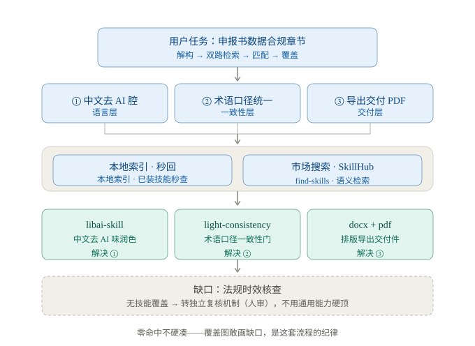

# Lumin Job Criterion (LJC)

**任务技能路由器** —— 开始一个任务时，先把它模块化分解，本地与 GitHub 四路检索现成技能，过一道安全门，然后画出「任务 → 技能覆盖图」：每个技能解决哪一部分、哪里是缺口。

> A task-to-skill router: decompose your task, sweep local + GitHub catalogs, gate on security, and draw the coverage map.

触发语句（技能模式）：「**请ljc为我指点迷津**」（LJC / ljc 大小写均可）。  
等价说法（歧义更小，推荐）：「**用 LJC 找技能**：<任务>」「**让 LJC 路由这个任务**：<任务>」。


## English

**LJC (Lumin Job Criterion)** is a task-to-skill router: it decomposes your task into modules, sweeps your installed skills plus GitHub (repo radar + four skill catalogs), gates candidates through a security check, and draws a *task → skill coverage map* showing which skill covers what — and where the gaps are.

Pure standard-library Python, zero dependencies. Skill-mode trigger: say “请ljc为我指点迷津” or “用 ljc 技能：<task>” (the registered skill name is `ljc`). All scripts also work standalone:

```bash
python3 scripts/find.py query "convert word documents" --top 8   # search installed skills
python3 scripts/find.py suggest "your task description"          # relevant vs not-needed audit
python3 scripts/github_search.py "skill router"                  # GitHub repo radar
python3 scripts/github_search.py "diagram" --catalog             # four skill catalogs
python3 scripts/security_check.py <path-or-owner/repo>           # BLOCK/WARN/PASS gate
python3 scripts/check_updates.py                                 # update detection
python3 scripts/find.py doctor                                   # self health check
```

## 为什么做这个

技能越装越多（100+ 是常态），接任务时却不知道有什么可用的：

- `find-skills` 类工具只搜**远程市场**，不知道你本地装了什么
- `skill_management` 只能列名字，不能按功能查
- 关键词命中 ≠ 真能干这活——不实推荐比不推荐更糟

LJC 把「找技能」从碰运气变成流水线：

```
任务进来 → 模块化分解（L0→L1→L2）→ 四路检索 → 安全门 + 读原文核实 → 覆盖图 → 盘点建议
```



*上图是一次真实路由的输出形态：任务拆成三个子任务，三个技能分别认领，缺口被如实画出。*

## 特性

- **模块化分解**：大任务拆成 L1 模块 + L2 小任务，每个小任务带产出物、可验证的完成标准、依赖标注
- **四路检索**：本地索引（秒回）+ GitHub 仓库雷达（按星扫库）+ 四个技能目录（2 个社区 awesome + anthropics/skills 与 claude-plugins-official 两个官方仓库）+ SkillsMP MCP（接入即用，覆盖面最广）
- **安全门**：每个候选推荐前过 BLOCK / WARN / PASS 三档检查——管道执行远程脚本、编码载荷、提示词注入、凭证泄漏一律 BLOCK
- **任务盘点**：`suggest` 分出「任务相关」与「本次用不到」，停不停、停哪些你说了算
- **未注册挑明**：下载了但被作者禁用模型调用的技能，指出「下载了，但没有注册」+ 照样介绍功能 + 给开放路径
- **双层语义**：词袋（内置 TF-IDF / 模糊匹配 / 130+ 中英术语映射）+ **可选向量后端**（软依赖：环境里装了 `sentence-transformers` / `fastembed` / `openai` 或自备嵌入命令就自动启用，没装静默回退）
- **纯标准库**：零依赖，clone 即用；`LJC_SKILLS_DIR` / `GITHUB_TOKEN` / `LJC_CACHE_DIR` 可配
- **可发布可分发**：SKILL.md 标准格式，任何兼容客户端都能用；脚本也可脱离技能框架单独跑

## 安装

```bash
git clone https://github.com/<your-name>/lumin-job-criterion.git
cd lumin-job-criterion
python3 scripts/find.py build   # 建本地索引（之后索引过期会自动重建，一般无需手动）
```

作为技能使用（WorkBuddy / Claude Code 等 SKILL.md 体系）：

```bash
ln -s "$PWD" ~/.workbuddy/skills/lumin-job-criterion
```

（停用 = `rm` 符号链接，仓库本体不动。）

> 技能注册名是 **`ljc`**（触发匹配用：用户说「请ljc为我指点迷津」或任何含  
> ljc 的消息即命中）；目录名与仓库名保持 `lumin-job-criterion` 不变。  
> 若自动触发偶有不灵，最稳的方式是点名：「用 ljc 技能：<任务>」。

## 用法

技能模式：对 AI 说「请ljc为我指点迷津」+ 你的任务。

脚本直用（无需技能框架，任何人、任何 Agent 都能跑，纯标准库）：

```bash
# 本地已装技能检索（秒回、零网络；中英文均可）
python3 scripts/find.py query "法律文书 信息抽取" --top 8

# 任务盘点：相关候选 vs 本次用不到（可暂时关掉的候选，停用需同意）
python3 scripts/find.py suggest "把申报书数据合规章节加工成评委友好版"

# GitHub 仓库雷达：按关键词扫技能仓库（按星排序）
python3 scripts/github_search.py "legal document extraction"

# GitHub 技能目录：四个目录全文检索（837+177 社区条目 + 两个官方仓库）
python3 scripts/github_search.py "diagram" --catalog
python3 scripts/github_search.py "diagram" --catalog --refresh   # 强制刷新缓存

# 安全检查：推荐前必过的门（本地目录或 owner/repo）
python3 scripts/security_check.py ~/.workbuddy/skills/some-skill
python3 scripts/security_check.py kevanwee/legal-extraction-skill

# 更新检测：已装技能哪些有上游新版本（全量或指定技能）
python3 scripts/check_updates.py
python3 scripts/check_updates.py code-review pdf

# 重建索引 / 列出全部已索引技能
python3 scripts/find.py build
python3 scripts/find.py list

# 语义后端自检：探测到什么、缓存状态、没探测到怎么开
python3 scripts/find.py semantic
```

## 四个检索通道

| 通道                | 命令                           | 特点                                                 |
| ----------------- | ---------------------------- | -------------------------------------------------- |
| 本地已装              | `find.py query`              | 秒回零网络；自动识别「下载了但未注册」                                |
| GitHub 仓库雷达       | `github_search.py`           | 搜索 API 按星排序；未认证 10 次/分                             |
| GitHub 技能目录       | `github_search.py --catalog` | 2 个社区 awesome + 2 个官方仓库（树形抓取）；7 天缓存，`--refresh` 强刷 |
| SkillsMP（MCP 连接器） | 客户端的 SkillsMP MCP 工具         | 百万级 SKILL.md 聚合市场，覆盖面最广；接入了就用，没接入说清                |
| 语义市场（可选）          | LJC 流程内 curl SkillHub        | 前几路不满意时再用                                          |

通道之间不短路：本地秒回但只覆盖已装；GitHub 覆盖开源公开；SkillsMP 面最广但质量参差。至少覆盖「本地 + GitHub + 其一市场」再下结论。

## 语义检索：词袋 + 可选向量后端

本地检索默认跑**纯标准库 TF-IDF**（外加模糊匹配与 130+ 条中英术语映射）。它是**词袋级**的：
比字符重叠，不懂含义——「帮我找个能审合同的」与描述 `review agreement risk` 字符零重叠，词袋打 0 分。

想补上这一层，有两种办法，本项目两种都留了口子：

| 办法                 | 怎么开                                                                                                          | 代价                          |
| ------------------ | ------------------------------------------------------------------------------------------------------------ | --------------------------- |
| **宿主模型意译**（零依赖，默认靠它） | 检索前把任务意译成 3–5 组语义相同、措辞不同的查询（中英皆可），分别检索后合并去重——SKILL.md 已写进流程，立即生效                                             | 多跑几次检索，零安装                  |
| **向量后端**（软依赖，自动探测）  | `pip install sentence-transformers`（或 `fastembed`）；也可 `export LJC_SEMANTIC_CMD='你的嵌入命令'`，或装 `openai` + 设 API KEY | 本机模型约 100MB–2GB；云端要联网、有隐私代价 |

设计取舍：**`find.py` 永不 import 任何第三方库**——用了 `importlib.util.find_spec` 探测，
探测到才加载；探测不到、或加载/调用失败，一律**静默回退词袋**，绝不报错、绝不影响主流程。
所以纯净环境 clone 下来照样能跑，装了库的人自动多一层召回。

融合规则与三道防噪声闸门（都在 `find.py` 里，可调）：

- 两个引擎衡量同一件事，**取较强者**而不是相加；两者都给出有效信号才额外 +5（一致性）
- **绝对下限** `VEC_FLOOR=0.35`：余弦对不相干短文本也常给出 0.3–0.5，低于此不计分
- **相对门槛** `VEC_REL_RATIO=0.8`：零关键词要被捞回，需 ≥ 本轮最高分的 80%
- **名额上限** `VEC_RESCUE_MAX=10`：语义召回是补位，不是把半库搬出来

**懒加载（重要）**：加载模型约 10–15 秒，词袋检索 0.1 秒——「秒回」是本地检索的命根子，
不能为锦上添花的能力把它赔进去。所以规则是：**关键词命中 ≥3 个就不加载模型**，
只有词袋答不上来（零命中/弱命中）时才请模型出山（连「换解释器」这一步也是懒的）。
实测：常规查询 **0.107 秒**（不加载模型）；零命中查询 16 秒（首次含编码 179 条）。

**默认模型 `BAAI/bge-m3`**（检索型多语言，1024 维；`pip install sentence-transformers` 后自动下载）。
选型依据是 2026-10-26 的真机 A/B（8 查询 × 179 技能）：检索型模型衡量「该不该被检索到」，
释义型（paraphrase-*）衡量「两句话像不像」，后者不是为检索设计的。bge-m3 在「画流程图」
上给对 `editorial-diagram-designer`，paraphrase 给错 `writing-shape`；余弦分布也从
0.36–0.55 抬到 0.49–0.63（区分度更好）。bge/e5/gte 系**必须带 `query:` / `passage:` 前缀**，
脚本按模型名自动加，不用手工配。换模型：`export LJC_SEMANTIC_MODEL=...`。

向量结果按索引指纹缓存到 `scripts/.cache/embeddings.json`（技能集合或索引一变就作废重算）。
自检：`python3 scripts/find.py semantic`；关闭：`export LJC_SEMANTIC=off`。

> **跨解释器重启**：脚本可能是被「没装嵌入库的那个 python」跑的（技能里写的就是通用
> `python3`），而按隔离惯例包装在 venv 里。探测不到时，`find.py` 会去找别处装了嵌入库的
> 解释器（`LJC_SEMANTIC_PY`，或 `~/.workbuddy/binaries/python/envs/*/bin/python3`），
> 找到了就换解释器重启自己（结果缓存，只 fork 一次）。换不成就用当前的继续跑，绝不报错。
> 全程受 `LJC_NO_REEXEC=1` 与 `LJC_SEMANTIC=off` 控制。

## 安全检查（推荐前的门）

每个候选推荐前必须过 `security_check.py`：

- **BLOCK**：管道执行远程脚本、编码载荷、提示词注入、凭证泄漏——  
  **照常告诉用户有这个东西**，逐条说明风险，由用户自行定夺（不代否决）
- **WARN**：缺 license、脚本含网络调用、星数过低、仓库已归档——推荐时必须附警告
- **PASS**：未发现风险项（仍建议读一遍原文）

无论哪一档，LJC 都**不代为下载、安装或执行**——只给信息、路径和命令。  
启发式检查，会误报（讨论安全话题的技能自带关键词）；机器负责不漏报，最终判断靠人。  
本地已装候选可另跑 `jason-security-audit` 技能的 `audit.py` 深审（若装着）。  
GitHub 目标若是合集仓库（如 `anthropics/skills`），自动树形抽检其中 SKILL.md 与代码文件（封顶 15 + 5 个）。

## 更新检测

推荐前顺手查「已装技能有没有过期」：

```bash
python3 scripts/check_updates.py                        # 全量更新检测
python3 scripts/check_updates.py code-review pdf        # 指定技能
python3 scripts/check_updates.py --record superpowers   # 更新后记录新 SHA
python3 scripts/find.py stats --top 10                  # 命中统计 + 从未命中的死技能
python3 scripts/find.py query "..." --json              # 机器可读输出
python3 scripts/find.py doctor                          # 一键自检
```

三轨检测：

| 来源类型              | 判定方式                               | 精度            |
| ----------------- | ---------------------------------- | ------------- |
| git 仓库（ecc-study） | fetch + 本地 HEAD vs 上游              | 精确            |
| tarball（已记录 SHA）  | `git ls-remote` 比 SHA——不走 API、不吃限额 | 精确            |
| tarball（未记录 SHA）  | GitHub API 日期启发式                   | 参考（对纯删除提交会误报） |
| pinned            | 暂停自动判定（上游更旧/有意分叉时）                 | —             |

输出分「已是最新 / 可更新 / 可能可更新 / 已固定 / 无法检测」五档，  
可更新的给出具体命令，本地单文件技能折叠成一行跳过。

**标准更新流程**：重新下载 tarball → 跑 `--record <来源名>` 把新 SHA 写进  
`scripts/ljc_sources.json`（语义=本地已同步到该 commit）→ 之后检测零误报。  
登记/固定来源：编辑 `scripts/ljc_sources.json`（形态说明见 `.example.json`）。

更新纪律：**只检测不自动执行**——git 来源用户同意后 `git pull`，  
tarball 来源由 LJC 重新下载。

## 任务盘点与停用建议

`find.py suggest "<任务描述>"` 把已装技能分成「任务相关」与「本次用不到」两组：

- 相关组：按相关度排序的候选（仍需读原文核实）
- 用不到组：**可暂时关掉**的候选（注意：用不到≠没用，只是这个任务不需要）

停用纪律：用户当次明确同意才停，只停确认过的；WorkBuddy 走 `skill_management` disable，恢复 = 用户去技能设置里重新打开。本技能永不自作主张停用。

## 「下载了，但没有注册」怎么办

有的技能装了，但作者在 SKILL.md 里写了 `disable-model-invocation: true`（禁用模型自动调用），Agent 会话里加载不到。LJC 的规矩（build 时逐个读 frontmatter 检测该标志，无需维护名单）：

1. 指出「下载了，但是没有注册」
2. 照样介绍功能
3. 给开放路径：经同意后移除该标志，下个会话可调用
4. 开放前不得混进可调用推荐

## 架构

```
lumin-job-criterion/
├── SKILL.md                 技能指令（双模式：任务路由 / 直接检索）
├── scripts/
│   ├── find.py              本地索引：build / query / suggest / list
│   ├── github_search.py     GitHub 通道：repo 雷达 + catalog 四目录
│   ├── security_check.py    安全门：BLOCK / WARN / PASS
│   └── ljc_terms.example.json  用户级术语扩展示例
├── tests/test_ljc.py        16 项零网络测试
├── docs/coverage-example.svg   覆盖图输出示例
└── index.json / .cache/     运行时产物（git 忽略）

数据流：find.py build 扫 LJC_SKILLS_DIR → index.json
        github_search.py catalog → .cache/（7 天 TTL）
        两路输出由 agent 按 SKILL.md 流程合并、核实、出图
```

## 环境变量与扩展

| 变量 / 文件                    | 作用                            | 默认                    |
| -------------------------- | ----------------------------- | --------------------- |
| `LJC_SKILLS_DIR`           | 用户技能目录位置                      | `~/.workbuddy/skills` |
| `LJC_SKILLS_DIRS`          | 完全自定义扫描根列表（冒号分隔，覆盖默认）         | 无                     |
| `GITHUB_TOKEN`             | GitHub API 认证（提高限额）           | 无（未认证）                |
| `LJC_CACHE_DIR`            | 技能目录缓存位置                      | 脚本旁 `.cache/`         |
| `LJC_SEMANTIC`             | 语义后端开关：`auto`/`off`/`local`/`cloud`/`external` | `auto`（探测不到即回退词袋） |
| `LJC_SEMANTIC_MODEL`       | 覆盖嵌入模型名                       | 各后端默认（多语言小模型）    |
| `LJC_SEMANTIC_CMD`         | 自备嵌入命令（stdin 收 JSON 字符串数组，stdout 吐 JSON 二维数组） | 无         |
| `LJC_SEMANTIC_PY`          | 指定装了嵌入库的解释器（跨解释器重启用）      | 自动找托管 venv      |
| `LJC_NO_REEXEC`            | 禁止换解释器重启                        | 无（允许换）        |
| `scripts/ljc_terms.json`   | 用户自定义术语映射（复制示例文件创建，git 忽略）    | 无                     |
| `scripts/ljc_sources.json` | tarball 来源登记（复制示例文件创建，git 忽略） | 无                     |

索引扫描是**多根**的：用户技能目录 + WorkBuddy 内置技能  
（/Applications/…/workbuddy-builtin/skills，存在即自动纳入）+ 插件缓存  
（`~/.workbuddy/plugins/cache`，同插件多版本只取最新版，同名技能先到的根优先）。

## 测试

```bash
python3 tests/test_ljc.py   # 43 项，零网络、秒级（缓存用例用临时目录）
```

覆盖术语扩展与停用词、多词排序加成、停用标志检测、目录解析（markdown + 树形）、
安全模式三档、更新检测、多根索引，以及**语义后端双分支**（探测到即用 / 探测不到或
编码失败静默回退词袋、缓存复用与指纹失效、融合取强不取和、三道防噪声闸门）。  
新功能先写 RED 测试再实现——本仓库的纪律。

> 2026-10-26 修了一个测试自身的 bug：`unittest.main()` 曾被写在文件中间，
> 之后追加的测试类根本没被执行（现在已移到文件末尾）。

## FAQ / 故障排查

| 症状                   | 原因                            | 解法                                  |
| -------------------- | ----------------------------- | ----------------------------------- |
| GitHub 搜索 403 / 提示限额 | 未认证 search 10 次/分、core 60 次/时 | 设 `GITHUB_TOKEN`；或等限额重置             |
| 目录抓取失败               | 网络不通或限额                       | 有旧缓存会自动用并声明；`--refresh` 重试          |
| SkillsMP 搜不到         | 脚本不直连（API 403、页面 JS 渲染）       | 走 MCP 连接器；或 WebFetch 其搜索页           |
| 索引结果过期               | 装了新技能没 build                  | 自动重建（<1 秒，下次 query 生效）；也可手动 `build` |
| 安全检查误报               | 讨论安全话题的技能自带关键词                | 已知类；看命中行自己判断                        |
| 推荐了某技能但加载不了          | 它被作者禁用了模型调用                   | 输出分区会标明「下载了，但没有注册」+ 开放路径            |
| 中文查询 GitHub 命中少      | GitHub 搜索对中文效果差               | 脚本会警告；先想好英文关键词再搜                    |

## 设计纪律

1. **只读+不代劳**：不安装、不卸载、不停用任何技能，找到候选也**不代为下载/安装**（停用只发生在用户当次明确同意后，且通过客户端的停用机制执行）
2. **推荐前必读原文**：description 是各技能自述，可能有偏差
3. **安全门=如实说明，不代否决**：发现问题逐条向用户说明（含高危项挑明存在与风险），由用户定夺，不许静默跳过、也不许静默否决
4. **零命中不硬凑**：覆盖图敢画缺口，是这个技能的脸面
5. **未注册挑明，不静默**
6. **网络失败明说**，不假装搜过
7. **测试纪律**：改脚本先跑测试；新功能先写 RED 测试再实现

## 许可

MIT
